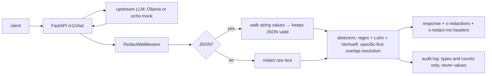

# LLM Output PII/Secret Redactor: FastAPI middleware

> **Lab project.** Every identifier in tests and data is synthetic: Aadhaar/card numbers are generated to pass checksums but aren't real. Built from scratch, with no ML dependencies.

## Problem
LLMs repeat what's in their context: tickets, logs and RAG documents full of emails, phone numbers, Aadhaar, PAN, card numbers and leaked API keys. If a support bot echoes an Aadhaar number to the wrong user, that's a DPDP Act problem. This project is an **ASGI middleware** that redacts every JSON/text response *before it leaves the service*. It works with any FastAPI LLM app and uses checksums so it doesn't redact every 12-digit order ID.

## Architecture


## Detects
| Type | How |
|---|---|
| AADHAAR | 12 digits, first digit 2–9, **Verhoeff check digit** (UIDAI scheme) |
| CARD | 13–19 digits with optional spaces/dashes, **Luhn** |
| PAN, IFSC, UPI, PHONE_IN (+91/0/10-digit 6–9) | format regex |
| EMAIL, IPV4 | regex |
| AWS_KEY, GITHUB_TOKEN, API_KEY (sk-), JWT, PRIVATE_KEY | secret formats |

## Run
```bash
python3 -m venv .venv && .venv/bin/pip install -r requirements-dev.txt
.venv/bin/pytest -q
python -m redactor.evaluate                               # P/R per type on data/eval.jsonl
uvicorn redactor.app:app --port 8080                      # echo-mock upstream (worst case: repeats input)
REDACTOR_UPSTREAM=ollama uvicorn redactor.app:app --port 8080
curl -s localhost:8080/v1/chat -H 'content-type: application/json' -d '{"prompt":"my card is 4111 1111 1111 1111"}'
docker build -t llm-redactor . && docker run -p 8080:8080 llm-redactor
```

## Results (actual runs, 2026-10-11)
**Offline eval** (`results/eval.json`). The set is 240 seeded sentences: 180 planted entities (15 per type × 12 types) and 60 hard negatives (invalid-checksum cards/Aadhaar, 12-digit order IDs, epoch timestamps, toll-free numbers, version strings).

| | Precision | Recall |
|---|---|---|
| ALL | **0.968** | **1.000** |
| 11 of 12 types | 1.000 | 1.000 |
| IPV4 | 0.714 | 1.000 (6 FPs: "Software version 4.12.0.1") |

Median detection latency is **13 µs**/sentence (p95 24 µs), pure Python, on one CPU core.

**Bug found by the eval.** The first card regex `(?:\d[ -]?){13,19}` swallowed the trailing space, so "4931 8393 3529 0422 " never matched the value exactly: CARD P/R 0.80. Fixed to `\d(?:[ -]?\d){12,18}`, then 1.00/1.00, with a regression test added.

**Live end-to-end with a real LLM** (`results/live_ollama_demo.txt`). qwen2.5:1.5b was asked to summarise a support ticket.
- Raw model output repeated the email, phone, **Aadhaar 2341 2341 2346**, card and UPI ID.
- Through the middleware: `"Customer Ravi Kumar, with Aadhaar [AADHAAR] and card [CARD], reports that his UPI payment to [UPI] failed."`, headers `x-redactions: 3`, `x-redact-ms: 0.27`. The log recorded only `['AADHAAR','CARD','UPI']`.
- The model's second answer happened to omit email/phone, so only 3 redactions were needed. The person's **name was not redacted** (see limitations).

pytest: **8 passed**.

## Limitations
- **No names or addresses.** Those need NER (spaCy/Presidio). Regex can't do it reliably.
- **No streaming.** The middleware buffers the whole body, which breaks SSE/token streaming and adds memory per response. Streaming needs a sliding-window redactor.
- Eval data is synthetic and templated by me, so recall on real LLM prose with odd formatting ("four one one one…", split across lines) will be lower.
- IPv4 vs version strings are ambiguous. A context-word heuristic would help.
- Only output is redacted. You'd still want to redact *before* sending to a third-party LLM (same detectors, request side).
- PHONE_IN only covers Indian mobile formats.

## Sources
- UIDAI, Aadhaar number structure (Verhoeff check digit): https://uidai.gov.in/ and https://en.wikipedia.org/wiki/Verhoeff_algorithm
- Luhn algorithm (ISO/IEC 7812-1): https://en.wikipedia.org/wiki/Luhn_algorithm
- Income Tax Dept, PAN structure: https://www.incometax.gov.in/iec/foportal/help/individual/return-applicable-1#pan
- RBI IFSC format: https://www.rbi.org.in/Scripts/IFSCMICRDetails.aspx
- Digital Personal Data Protection Act 2023: https://www.meity.gov.in/data-protection-framework
- OWASP LLM02 Sensitive Information Disclosure: https://genai.owasp.org/llmrisk/llm022025-sensitive-information-disclosure/
- GitHub token formats: https://github.blog/2021-04-05-behind-githubs-new-authentication-token-formats/
- Starlette middleware: https://www.starlette.io/middleware/ · Microsoft Presidio: https://github.com/microsoft/presidio

## Related work

This is my own implementation. Ideas came from [mthamil107/prompt-shield](https://github.com/mthamil107/prompt-shield) and Microsoft Presidio.
